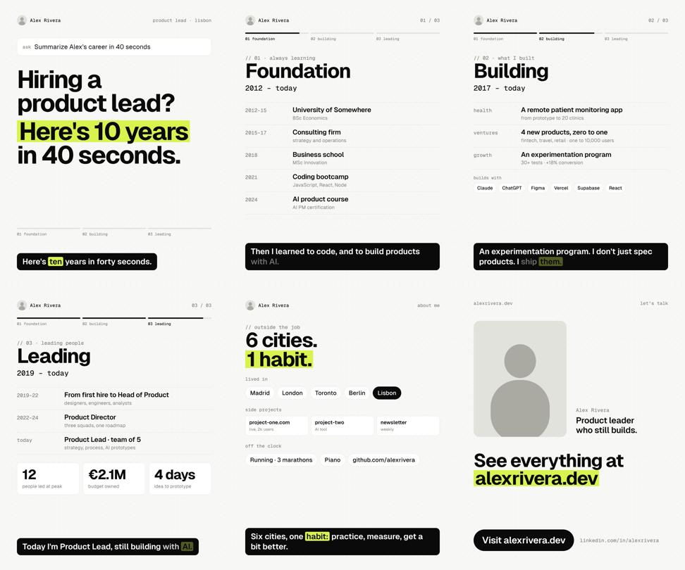

# CV Video — a Claude skill

Turn your career into a 45-second animated video with your own voice and synced captions. No video editor: an HTML template, a voiceover and a render script.



**What you get:** 1080x1350 (4:5) MP4, made for X and LinkedIn. Hook → Foundation → Building → Leading → About → call to action.

## Use it with Claude (easiest)

1. Download this repo as a ZIP (green **Code** button → **Download ZIP**).
2. Give the folder to Claude:
   - **Claude Code / Cowork:** put the `cv-video-skill` folder in your skills folder (e.g. `~/.claude/skills/`), or just attach the ZIP and ask Claude to use it.
   - **claude.ai:** Settings → Capabilities → Skills → upload the ZIP (needs a plan with code execution).
3. Say: *"Make my CV video"* and attach your CV and a photo. Claude writes the script, you record it (ElevenLabs or your own voice), send the mp3, and Claude renders the video.

## Do it yourself

Requirements: Node 18+, ffmpeg, Python 3.

```bash
cd template && npm install && npx playwright install chromium && cd ..
# 1. edit template/content.js with your story and replace template/photo.jpg
# 2. record your voiceover, then get the timings:
python3 scripts/timing.py voice.mp3
# 3. paste the times into template/content.js (timing.scenes, timing.lines, cues)
# 4. render
node scripts/render.js voice.mp3 cv-video.mp4
```

Preview any moment: open `template/index.html` in a browser, open the console and run `render(12)`.

## Files

| File | What it does |
|---|---|
| `SKILL.md` | Instructions Claude follows |
| `template/content.js` | Your story and timings (the only file you edit) |
| `template/index.html` + `engine.js` | Builds and animates the screens |
| `scripts/timing.py` | Lists speech segments of your voiceover |
| `scripts/render.js` | Renders frames and adds your voice with ffmpeg |

Made by [@GomezveraF](https://x.com/GomezveraF). MIT license.
